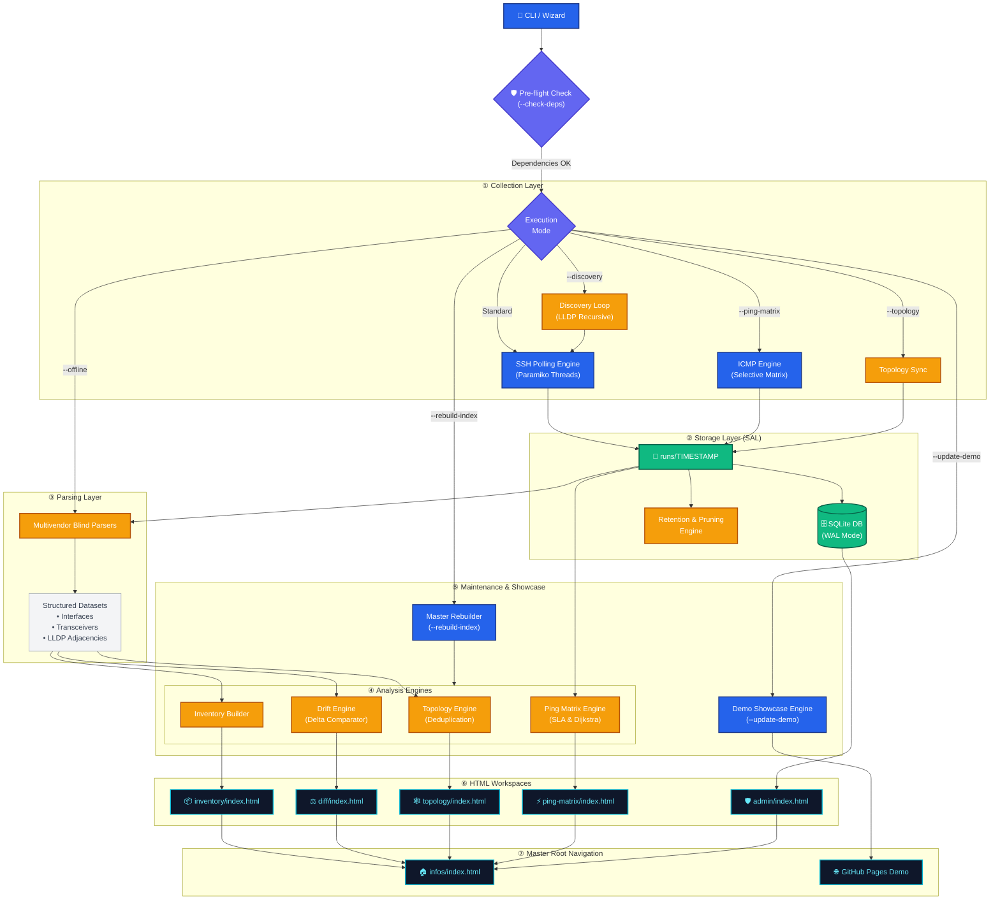

# 🏗️ System Architecture & Engineering Blueprints

This document details the internal design, processing layers, and navigation graph of the **Network Data Extractor**.

---

## 📑 Table of Contents
1. [High-Level Processing Pipeline (7 Layers)](#high-level-processing-pipeline-7-layers)
2. [Inter-Dashboard Contextual Navigation Network](#inter-dashboard-contextual-navigation-network)
3. [URL Parameter Contract](#url-parameter-contract)
4. [Output Directory Structure](#output-directory-structure)
5. [Client-Side Single-Page Application (SPA) Design](#client-side-single-page-application-spa-design)

---

## 🏛️ High-Level Processing Pipeline (7 Layers)

The orchestrator operates as a modular, unidirectional pipeline with integrated pre-flight diagnostics:



---

## 🔗 Inter-Dashboard Contextual Navigation Network

All diagnostic views are contextually interconnected. When inspecting an interface row, a topology link, or an ICMP matrix cell, a popover menu allows jumping across workspaces with pre-filtered parameters:

```mermaid
flowchart LR

%% ==========================================================
%% STYLES
%% ==========================================================
classDef root fill:#0284c7,stroke:#0369a1,stroke-width:2px,color:#fff,rx:8,ry:8
classDef workspace fill:#0F172A,stroke:#06B6D4,stroke-width:2px,color:#67E8F9,rx:6,ry:6
classDef menu fill:#D97706,stroke:#78350F,stroke-width:2px,color:#fff,rx:12,ry:12
classDef subview fill:#059669,stroke:#064E3B,stroke-width:2px,color:#fff,rx:6,ry:6

%% ==========================================================
%% STEP 1: ENTRY HUB
%% ==========================================================
subgraph STEP1["🌐 STEP 1: ENTRY HUB"]
    ROOT["🏠 Root Navigation Portal<br/>(infos/index.html)"]:::root
end

%% ==========================================================
%% STEP 2: NETWORK WORKSPACES
%% ==========================================================
subgraph STEP2["📊 STEP 2: WORKSPACES"]
    INV["📦 Global Inventory<br/>(inventory/index.html)"]:::workspace
    DIFF["⚖️ Drift Analysis<br/>(diff/index.html)"]:::workspace
    TOPO["🕸️ Network Topology<br/>(topology/index.html)"]:::workspace
    PM["⚡ Ping Matrix & SLA<br/>(ping-matrix/index.html)"]:::workspace
    ADMIN["🛡️ Admin & Operations<br/>(admin/index.html)"]:::workspace
end

ROOT -->|Select| INV
ROOT -->|Select| DIFF
ROOT -->|Select| TOPO
ROOT -->|Select| PM
ROOT -->|Select (DB Mode)| ADMIN

%% ==========================================================
%% STEP 3: CONTEXT ENGINE
%% ==========================================================
subgraph STEP3["🖱️ STEP 3: CONTEXT ENGINE"]
    MENU["👆 Context Popover Menu<br/>(Click on Cell / Node / Link)"]:::menu
end

INV -->|Click Link| MENU
DIFF -->|Click Event| MENU
TOPO -->|Click Node| MENU
PM -->|Click Cell| MENU

%% ==========================================================
%% STEP 4: TARGET DIAGNOSTIC VIEWS
%% ==========================================================
subgraph STEP4["🔬 STEP 4: DIAGNOSTIC VIEWS"]
    HIST["📈 P2P SLA History<br/>(history.html)"]:::subview
    PATH["🗺️ Dijkstra Path Simulator<br/>(path.html)"]:::subview
    TIME["⏱️ Interface Timeline<br/>(diff/index.html#timeline)"]:::subview
    MAP["🔍 Topology Focused View<br/>(topology/index.html?focus=)"]:::subview
end

MENU -->|"?origin=X&dest=Y"| HIST
MENU -->|"?origin=X&dest=Y&run=T"| PATH
MENU -->|"?device=X&interface=Y"| TIME
MENU -->|"?focus=DeviceName"| MAP
```

---

## 📡 URL Parameter Contract

The dashboards exchange context via URL query parameters:

| Parameter | Type | Example | Supported Dashboards | Action |
| :--- | :--- | :--- | :--- | :--- |
| `run` | String | `20261014_140000` | All Dashboards | Selects the active snapshot collection timestamp. |
| `origin` | String | `BR-DF-BSB-CORE-01` | `history.html`, `path.html` | Pre-selects source node for latency and routing paths. |
| `dest` | String | `BR-SP-SPO-AGG-01` | `history.html`, `path.html` | Pre-selects destination node for latency and routing paths. |
| `focus` | String | `BR-RJ-RIO-EDGE-02` | `topology/index.html` | Centers camera, zooms, and highlights node with glowing halo. |
| `device` | String | `CORE-ROUTER-01` | `diff/index.html` | Filters interface drift timeline to a single device. |
| `interface`| String | `TenGigE0/0/0/1` | `diff/index.html` | Zooms into specific interface state history. |

---

## 📂 Output Directory Structure

Every collection creates an isolated, self-contained run folder inside `runs/`:

```
infos/
├── index.html                               # Root Master Navigation Portal
├── ndx_telemetry.db                         # SQLite Database (when in hybrid/db_only mode)
├── inventory/
│   ├── index.html                           # Cumulative Inventory SPA
│   └── manifest.js                          # Inventory Cache
├── diff/
│   ├── index.html                           # Drift Analysis SPA
│   └── manifest.js                          # Run Comparison Manifest
├── topology/
│   ├── index.html                           # Interactive Canvas & Vector Topology SPA
│   └── manifest.js                          # Multi-Snapshot Topology Manifest
├── ping-matrix/
│   ├── index.html                           # Ping Matrix Index
│   ├── history.html                         # P2P Latency & Loss History (Chart.js)
│   ├── path.html                            # Dijkstra Shortest-Path Simulator
│   └── history/                             # JSON Telemetry series per link
└── runs/
    └── YYYYMMDD_HHMMSS/                     # Individual Snapshot Run Directory
        ├── collect/                         # Raw .txt CLI command dumps
        ├── resume/                          # Parsed .csv and .json tables
        │   ├── interfaces_all.json
        │   └── status.elements.csv
        ├── connections/                     # L2/L3 topology connection CSVs
        ├── ping-matrix/                     # ICMP test raw outputs and local matrix HTML
        ├── topology/                        # Draw.io (.drawio) XML and SVG diagrams
        └── log/                             # Execution and parser trace logs
```

---

## 🌐 Client-Side Single-Page Application (SPA) Design

The generated dashboards follow a **Local-First, Zero-CORS** architecture:
- All datasets are structured as lightweight `.js` manifests (`manifest.js`) assigning JSON objects to window-scoped variables.
- This allows full interactivity when opening pages via `file:///` in any browser without CORS security restrictions.
- In **DB Mode**, the dashboards enhance dynamically by querying REST API endpoints (`/api/v1/*`) to fetch sub-millisecond cached relational metrics.
